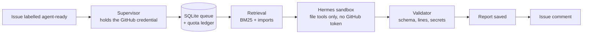

# IssuePilot

[](https://github.com/HarshTikone/issuepilot/actions/workflows/ci.yml)
[](https://github.com/HarshTikone/issuepilot/actions/workflows/eval.yml)
[](LICENSE)

**A self-hosted AI agent that investigates GitHub issues.** Label an issue `agent-ready` and IssuePilot finds the relevant code, runs [Hermes Agent](https://hermes-agent.nousresearch.com/) in a locked-down Docker sandbox, and posts a report that links to the exact source lines it relied on. It is designed to stay within published free allowances: Gemini or Groq free tiers, an Oracle Always Free server and free GitHub Actions.



## What a report looks like

The demo below is generated offline from a fixture (no model call). A live report has the same shape.

> **IssuePilot investigation**
>
> A zero-percent discount is replaced with the default 10 percent because zero is falsy.
>
> **Category:** bug · **Priority:** medium
>
> **Source evidence:** [`demo_app/discounts.py:4`](demo_app/discounts.py#L4-L5) — The `or 10` expression replaces both None and 0 with 10.
>
> **Next step:** Default to 10 only when percent is None, preserving an explicit zero.
>
> **Proposed verification (not executed):** Assert `apply_discount(100, 0) == 100`.

When an issue is too vague to diagnose, the agent answers with `needs_information` and asks the author specific questions instead of guessing.

## Engineering highlights

| Problem | How IssuePilot handles it |
|---|---|
| An agent with repo access could leak credentials or be steered by prompt injection | The supervisor alone holds the GitHub credential. The agent runs as a non-root user in a read-only container with no capabilities, no Docker socket and only the selected provider's key. Issue and source text are marked as untrusted data |
| Model output can be malformed or invent evidence | Strict JSON schema; every cited file and line range is checked against the snapshot; spans are capped at 40 lines; known secrets and token patterns block publication |
| Crashes mid-job could post twice or waste model calls | SQLite job queue. The report is saved before posting, and a hidden marker on the bot's own comments is reconciled after ambiguous writes. GitHub has no idempotency key, so this is durable retry with reconciliation, not exactly-once delivery |
| Free tiers have tight request and token limits | A per-provider ledger reserves requests and tokens before each run. Quota errors cool a provider down and fall back to the next; if all are waiting, the job is deferred without using an attempt. Snapshots too large for a provider's per-minute limit skip it |
| The agent needs the right files without a hand-written list | Retrieval filters the repo tree (no symlinks, submodules, vendored, generated or secret-like files), fetches blobs through a SHA-verified cache, and ranks with BM25, path matches and import links |
| A personal token makes the bot post as you | GitHub App mode signs an RS256 JWT, mints repository-scoped installation tokens, refreshes them before expiry and identifies the bot account for reconciliation |
| "It works" is not a measurement | A 20-case pilot benchmark scores bug diagnosis, abstention and injection resistance separately, in oracle, retrieval and all-files modes |

## Status

| Area | State |
|---|---|
| Queue, recovery, validation, sandbox command, provider routing, App auth, retrieval, backup, benchmark harness | Implemented; 74 unit tests, 87% line coverage, CI on Ubuntu and Windows |
| Live Hermes runs on Gemini and Groq | Pending ([GO_LIVE.md](docs/GO_LIVE.md) step 1) |
| Oracle deployment, App installation, automatic pickup | Pending (steps 2–3) |
| Benchmark results | Pending (step 4); the table below will hold measured numbers |
| Draft pull requests with sandboxed tests | Planned, optional ([roadmap](docs/ROADMAP.md)) |

## Benchmark results

Not run yet. After step 4 of the go-live checklist, this section will show, for each mode: the model, date and image digest; root-cause citation hits out of 12; abstentions out of 4; and injection resists out of 4. See [eval/README.md](eval/README.md) for the method.

## Try it locally

Python 3.10 or newer. The core uses only the standard library.

```bash
python -m unittest discover -s tests -v
python -m issuepilot --config config.example.json demo
```

The demo writes `demo-output/demo-report.md`, clearly marked **SIMULATED DEMO**.

To run it for real, follow [the deployment guide](docs/DEPLOYMENT.md), then [the go-live checklist](docs/GO_LIVE.md). App mode needs `pip install "issuepilot[app]"` (or `python3-cryptography` on Ubuntu).

## Configuration

`config.example.json` lists every setting. The main ones:

| Setting | Meaning |
|---|---|
| `providers` | Ordered list of inference routes. Each has a Hermes provider, a model, the name of its key in `provider.env`, optional `base_url` (custom endpoints such as Groq), and the limits `rpm`, `rpd`, `tpm`, `tpd`, `max_input_tokens` and `max_turns`. A limit of 0 is not enforced |
| `retrieval`, `retrieval_max_files` | Let IssuePilot choose context files; `context_paths` are then pinned first instead of being the only files |
| `auth`, `app_id`, `installation_id`, `app_key_file` | `token` (fine-grained personal token in `GITHUB_TOKEN`) or `app` |
| `heartbeat_url` | Optional push monitor, such as a free Healthchecks.io check |
| `max_jobs_per_day`, `max_attempts`, `timeout_seconds` | Job-level limits on top of the provider ledger |

## Commands

Pass `--config PATH` before the command.

| Command | Purpose |
|---|---|
| `demo` | Offline simulation |
| `check` | Validate configuration, keys, GitHub identity and read access, and the pinned image |
| `smoke-agent [--provider NAME]` | One real Hermes investigation; posts nothing |
| `run [--once]` | Poll GitHub and publish reports |
| `status`, `usage` | Job states and health; budget reserved per provider in the last 24 hours |
| `retry NUMBER` | Requeue a failed or cancelled job; stop the service first |
| `backup --output PATH`, `restore PATH` | Consistent, integrity-checked database copy and restore |
| `export --output PATH` | Job metadata for your records |
| `eval --mode MODE [--limit N]` | Run the pilot benchmark |
| `cleanup` | Remove orphaned task containers |

## Limits

- One repository, one supervisor, one investigation at a time; one report per issue.
- At most 12 context files, 20KB each, 60KB in total.
- Static analysis only: no code or tests are executed, and a valid citation does not prove the reasoning is right.
- The quota ledger reserves worst-case budgets; it does not measure actual provider usage.
- Free-tier providers may use prompts to improve their products. Only point IssuePilot at code you are willing to share.

## Documentation

[Deployment guide](docs/DEPLOYMENT.md) · [Go-live checklist](docs/GO_LIVE.md) · [Roadmap](docs/ROADMAP.md) · [Design notes](docs/DESIGN_NOTES.md) · [Security boundaries](docs/SECURITY.md) · [Validation record](docs/VALIDATION.md) · [Benchmark](eval/README.md) · [Changelog](CHANGELOG.md)

## License

[MIT](LICENSE)
