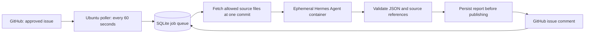

# IssuePilot

GitHub issue investigations with Hermes Agent and durable job tracking.

IssuePilot watches one repository for an `agent-ready` label, asks Hermes to inspect a bounded source snapshot, and automatically posts a report with source links, likely cause, proposed changes, and verification steps. You start the service once; each issue is picked up without a terminal command.

## Start here

1. Read [the roadmap](docs/ROADMAP.md) for the next milestones and their completion checks.
2. Run the offline demo below.
3. Follow [the Windows-to-Linux deployment guide](docs/DEPLOYMENT.md), including creating your first SSH key and server.
4. Read [the upgrade-plan review](docs/UPGRADE_PLAN_REVIEW.md) before adding free providers, retrieval or draft PRs.

## What is delivered

| Component | Status |
|---|---|
| Durable GitHub poller, worker, SQLite queue | Implemented; tested locally |
| Hermes container adapter and report contract | Implemented; real image/provider execution pending |
| Source revision links and line-range validation | Implemented; tested locally |
| Crash recovery, retry/backoff, rolling call limit | Implemented; tested locally |
| Loopback health and readiness endpoints | Implemented |
| Ubuntu service, setup wizard and operations guide | Prepared; Linux execution pending |
| Offline workflow demo and automated checks | 40 checks passed on Windows, Python 3.10 |
| GitHub issue comment, live Hermes task, rented VPS | Not performed; requires your accounts and server |

## Offline demo

Requires Python 3.10 or newer. The supervisor uses only Python's standard library; no packages to install.

```powershell
python -m unittest discover -s tests -v
python -m issuepilot --config config.example.json demo
```

Open `demo-output/demo-report.md` and `demo-output/demo-result.json`. The fixture models a zero-percent discount bug in `demo_app/discounts.py`. Its result is clearly marked **SIMULATED DEMO**: it does not install Hermes, call a model, contact GitHub, or deploy Linux.

## How it works



The supervisor alone holds the GitHub token. Hermes receives only an issue snapshot, selected source text and a model credential. Its container runs without host control mounts or the Docker socket. Its file tools can inspect the snapshot; no repository code or tests are executed. See [security boundaries](docs/SECURITY.md).

The first version completes **investigation tasks**. Automated code fixes, pull requests, test execution, Slack, and multi-repository support are later milestones described in the plan.

## Commands

Pass `--config PATH` before the command.

| Command | Purpose |
|---|---|
| `demo` | Safe offline simulation |
| `check` | Validate configuration, image presence and GitHub read access |
| `smoke-agent` | One real model-backed Hermes investigation; no GitHub posting |
| `run` | Continuous automatic discovery and publication |
| `run --once` | One discovery and one due job; useful during setup |
| `status` | Read durable job states while the service runs |
| `retry NUMBER` | Requeue failed/cancelled work; stop the service first |
| `export --output PATH` | Export job metadata for your evidence folder |
| `cleanup` | Remove orphaned task containers on the dedicated VPS |

## Operational limits

- One repository, one supervisor and one investigation process at a time; one report per issue.
- At most 12 context files, 20KB each, 60KB combined. Missing or excessive context fails visibly.
- Three attempts, exponential backoff, and a rolling 24-hour limit of ten investigator starts by default. Each investigation can make multiple model requests. Request/token accounting is planned; the current job limit cannot enforce a provider's free quota or a dollar budget.
- GitHub comment reconciliation reduces duplicates after crashes. The GitHub API does not provide an atomic idempotency key for comment creation, so exactly-once delivery cannot be guaranteed during unusual API visibility delays.
- Source-reference validation checks paths and line ranges. It does not prove the model's causal reasoning; review the report.
- A token issued by your own account posts as that account. A dedicated GitHub App identity is a later improvement.

## Official references

Integration design was checked against [Hermes CLI documentation](https://hermes-agent.nousresearch.com/docs/user-guide/cli), [the official Hermes Docker guide](https://hermes-agent.nousresearch.com/docs/user-guide/docker), and [GitHub's issue comments API](https://docs.github.com/en/rest/issues/comments). Pin and smoke-test the chosen Hermes image before enabling the service; upstream CLI behavior changes over time.
